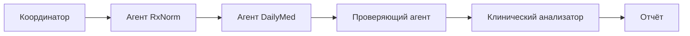

# ИИ клинический фармаколог

Учебное мультиагентное web-приложение для проверки лекарственной терапии по данным [RxNorm](https://lhncbc.nlm.nih.gov/RxNav/APIs/RxNormAPIs.html) и [DailyMed](https://dailymed.nlm.nih.gov/dailymed/app-support-web-services.cfm).

[Открыть рабочее приложение](https://ai-clinical-pharmacologist.quiet-harp-4900.chatgpt.site)

Приложение принимает до шести препаратов и учитывает возраст, СКФ, аллергии, диагнозы, беременность и лактацию. Рабочая версия не использует LLM: вывод формируют детерминированные правила, а каждый фрагмент можно проверить по инструкции DailyMed.

> Учебный информационный сервис. Он не назначает лечение, не рассчитывает дозу и не заменяет решение врача.

## Возможности

- распознавание вещества, дозировки и лекарственной формы через RxNorm;
- раскрытие компонента дозировки до конкретного продукта;
- проверка связи RxCUI с SET ID инструкции DailyMed;
- поиск дублирования действующих веществ;
- сопоставление аллергий с ингредиентами;
- поиск упоминаний других препаратов в разделе взаимодействий;
- извлечение разделов для функции почек, пожилого возраста, беременности и лактации;
- экспорт результата в JSON;
- серверный адаптер для будущего подключения LLM.

## Архитектура



1. Координатор проверяет ввод и запускает обработку препаратов параллельно.
2. Агент RxNorm нормализует название и ранжирует подходящие лекарственные формы.
3. Агент DailyMed получает список инструкций и SPL XML.
4. Проверяющий агент подтверждает связь инструкции с выбранным RxCUI.
5. Клинический анализатор применяет проверяемые правила к тексту инструкции.

## Запуск

Требуется Node.js 22 или новее. Внешние npm-зависимости не нужны.

```bash
git clone https://github.com/bonbon612/ai-clinical-pharmacologist.git
cd ai-clinical-pharmacologist
npm start
```

Откройте <http://127.0.0.1:4173/>.

## Проверка

```bash
npm test
npm run build
npm run check
```

Сборка создаёт автономный Cloudflare Worker в `dist/server/index.js` со встроенными HTML, CSS и JavaScript.

## API

| Маршрут | Назначение |
|---|---|
| `GET /api/review?meds=...` | Полный разбор списка препаратов |
| `GET /api/search?q=...` | Поиск записей RxNorm |
| `GET /api/passport?id=...` | Данные RxNorm и инструкции DailyMed |
| `GET /api/label?setid=...&id=...` | Проверенная инструкция SPL |

## Пример

```text
metformin 500 mg
ibuprofen 200 mg
```

Возраст: `67`, СКФ: `45`.

Приложение распознаёт оба продукта, проверяет инструкции и показывает разделы по функции почек и пожилому возрасту.

## Структура

```text
lib/                 агенты, правила и адаптер LLM
public/              web-интерфейс
tests/               автоматические тесты
docs/                доклад и презентация
server.mjs           HTTP API
local-server.mjs     локальный сервер
build.mjs            сборка Worker
```

## Материалы проекта

- [Доклад PDF](docs/AI_clinical_pharmacologist_report.pdf)
- [Доклад DOCX](docs/AI_clinical_pharmacologist_report.docx)
- [Презентация](docs/AI_clinical_pharmacologist_presentation.pptx)

## Ограничения

- RxNorm и DailyMed описывают рынок и инструкции США.
- Российские торговые названия могут отсутствовать.
- Совпадение текста указывает на раздел для проверки специалистом и не доказывает наличие взаимодействия или противопоказания.
- Отсутствие найденного предупреждения не подтверждает безопасность комбинации.
- Не вводите персональные данные пациента.

## Подключение LLM

`lib/llm-adapter.mjs` отключён по умолчанию. Адаптер принимает только проверенные фрагменты источников и отклоняет ссылки на доказательства, которых не было во входных данных. Перед включением модели нужны экспертная валидация, размеченная тестовая выборка, защищённое хранение ключа и контроль доступа.

## Источники

- [RxNorm API](https://lhncbc.nlm.nih.gov/RxNav/APIs/RxNormAPIs.html)
- [DailyMed Web Services](https://dailymed.nlm.nih.gov/dailymed/app-support-web-services.cfm)
- [DailyMed SPL API](https://dailymed.nlm.nih.gov/dailymed/webservices-help/v2/spls_api.cfm)
- [Лекции по мультиагентным системам](https://edwfa.github.io/mas-lecture/)
