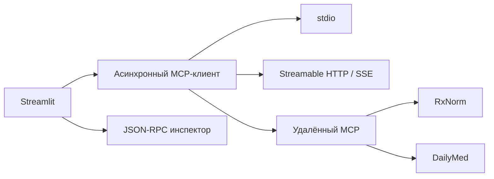

# ИИ клинический фармаколог

Учебная мультиагентная система с двумя интерфейсами:

- [web-приложение RxNorm + DailyMed](https://ai-clinical-pharmacologist.quiet-harp-4900.chatgpt.site/);
- MCP-лаборатория с `stdio`, Streamable HTTP/SSE и удалённым провайдером доказательств.

Система работает без LLM. Клинические калькуляторы детерминированы, а сведения о лекарствах поступают из [RxNorm](https://lhncbc.nlm.nih.gov/RxNav/APIs/RxNormAPIs.html) и [DailyMed](https://dailymed.nlm.nih.gov/dailymed/app-support-web-services.cfm).

> Учебный информационный сервис. Клиническое решение принимает специалист.

## Практическое задание 2

| Провайдер | Транспорт | Инструменты |
|---|---|---|
| `clinical-calculators` | JSON-RPC 2.0 через stdin/stdout | ИМТ, CKD-EPI 2021, Cockcroft–Gault, CHA₂DS₂-VASc, GCS, каталог |
| `clinical-calculators` | Streamable HTTP `:8000/mcp`; совместимый SSE `/sse` + `/messages` | те же 6 инструментов с общей валидацией |
| `clinical-evidence` | удалённый HTTP `POST /api/mcp` | поиск RxNorm, инструкции DailyMed, проверка терапии |



Web-интерфейс получает список инструментов через `tools/list`, строит поля по `inputSchema` и выполняет выбранный инструмент через `tools/call`. Прямых вызовов функций из интерфейса нет.

## Запуск MCP-лаборатории

Требуется Python 3.11 или новее.

```powershell
python -m venv .venv
.venv\Scripts\python -m pip install -r requirements.txt
.venv\Scripts\python -m clinical_mcp.launcher
```

После установки последний запуск выполняется одной командой:

```powershell
.venv\Scripts\python -m clinical_mcp.launcher
```

Откройте <http://localhost:8501>. Launcher запускает сетевой MCP на `http://127.0.0.1:8000/mcp` и завершает его вместе с интерфейсом.

Отдельные режимы:

```powershell
# stdio — процесс запускает MCP-клиент
.venv\Scripts\python -m clinical_mcp.server

# Streamable HTTP
.venv\Scripts\python -m clinical_mcp.network_server

# SSE для совместимости
.venv\Scripts\python -m clinical_mcp.network_server --transport sse
```

Конфигурация для Cursor находится в [`.cursor/mcp.json`](.cursor/mcp.json).

## Демонстрация

1. `Локальный · stdio` → `calculate_bmi` → масса `70`, рост `175` → `22.9 кг/м²`.
2. `Сетевой · Streamable HTTP` → `calculate_gcs` → `4`, `5`, `6` → `15 баллов`.
3. `RxNorm + DailyMed · удалённый` → `search_rxnorm` → `metformin` → список RxCUI.
4. Откройте `JSON-RPC инспектор`: слева показан запрос `tools/call`, справа полный ответ.

## Основное web-приложение

Оно принимает до шести препаратов и учитывает возраст, СКФ, аллергии, диагнозы, беременность и лактацию. Результат состоит из проверяемых правил и фрагментов инструкций DailyMed.

```bash
git clone https://github.com/bonbon612/ai-clinical-pharmacologist.git
cd ai-clinical-pharmacologist
npm start
```

Откройте <http://127.0.0.1:4173/>.

| Маршрут | Назначение |
|---|---|
| `GET /api/review?meds=...` | полный разбор списка препаратов |
| `GET /api/search?q=...` | поиск RxNorm |
| `GET /api/passport?id=...` | RxNorm и инструкции DailyMed |
| `GET /api/label?setid=...&id=...` | проверенная инструкция SPL |
| `POST /api/mcp` | удалённый JSON-RPC провайдер |

## Проверка

```powershell
npm run check
.venv\Scripts\python -m unittest discover -s tests -p "test_*.py"
```

Проверки охватывают расчёты, граничные значения, схемы инструментов, вызов через MCP-протокол и существующий анализ лекарств.

## Структура

```text
clinical_mcp/       калькуляторы, MCP-серверы, клиент, sanitizer, launcher
streamlit_app.py    интерфейс и JSON-RPC инспектор
lib/                агенты RxNorm/DailyMed и клинические правила
public/             основное web-приложение
tests/              Node и Python тесты
docs/               доклад, презентация, отчёт по практическому заданию 2
server.mjs          HTTP API и удалённый MCP
```

## Материалы

- [Отчёт по практическому заданию 2](docs/practical_assignment_2.md)
- [Доклад PDF](docs/AI_clinical_pharmacologist_report.pdf)
- [Доклад DOCX](docs/AI_clinical_pharmacologist_report.docx)
- [Презентация](docs/AI_clinical_pharmacologist_presentation.pptx)

## Ограничения

- RxNorm и DailyMed описывают рынок и инструкции США.
- Российские торговые названия могут отсутствовать.
- Результат калькулятора требует клинической интерпретации.
- Отсутствие найденного предупреждения не подтверждает безопасность комбинации.
- Не вводите персональные данные пациента.

## Технические источники

- [MCP Python SDK 2.x](https://py.sdk.modelcontextprotocol.io/)
- [MCP: запуск серверов](https://github.com/modelcontextprotocol/python-sdk/blob/main/docs/run/index.md)
- [MCP: клиентские транспорты](https://github.com/modelcontextprotocol/python-sdk/blob/main/docs/client/transports.md)
- [RxNorm API](https://lhncbc.nlm.nih.gov/RxNav/APIs/RxNormAPIs.html)
- [DailyMed Web Services](https://dailymed.nlm.nih.gov/dailymed/app-support-web-services.cfm)
- [Лекции по мультиагентным системам](https://edwfa.github.io/mas-lecture/)
